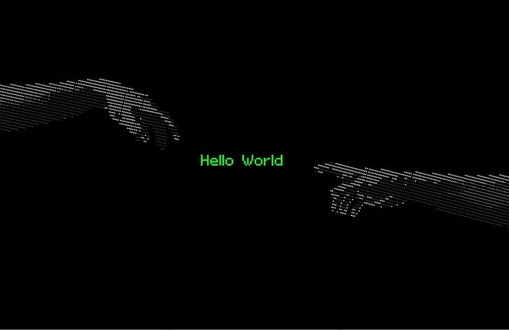
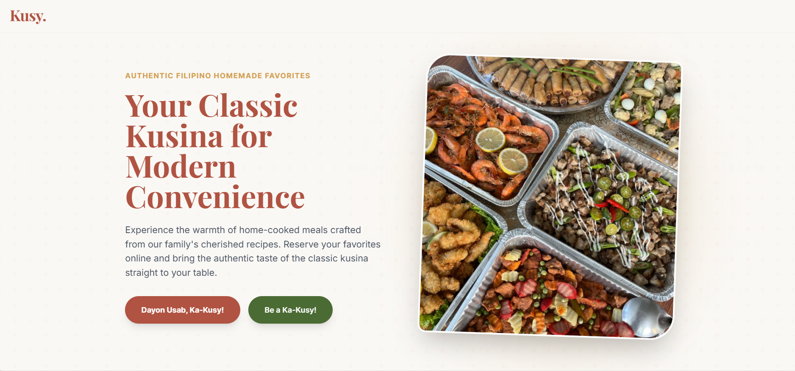

  

# Hi there, I'm Michael Angelou C. Quinit (Aenzari) 👋

> **4th-Year IT Student | Database Major | AI-Assisted Full-Stack Developer** 🚀
> I specialize in architecting scalable database schemas, integrating modern tech stacks, and deploying seamless, mobile-first web applications.

---

### 👨‍💻 About Me & My Workflow

*   🎓 **Academic Core:** Currently a 4th-year Information Technology student majoring in **Database Systems**. I build apps from the ground up, starting with how data is structured, queried, and protected.
*   🤖 **AI-Assisted Programmer:** I heavily leverage AI tools in my daily workflow to rapidly prototype architectures, optimize complex code logic, and accelerate my development cycles.
*   🌐 **System Deployment:** I don't just build locally; I have hands-on experience taking full-stack projects from a local environment all the way to live production deployment.
*   💻 **Current Focus:** Expanding my frontend capabilities by diving deep into **React**, while continuing to build robust backends with Node.js and **Supabase**.
*   ⌨️ **High-Speed Execution:** I type at sustained speeds of **95+ WPM**, which keeps me in the flow state during heavy coding and documentation sessions.
*   🎮 **Off the Keyboard:** When I am not pushing commits, I am usually playing football/futsal, or grinding competitive matches in Mobile Legends.

 

---

### 🛠️ Tech Stack & Arsenal

Here is the technology I use to bring my systems to life and deploy them to the web:

#### **Frontend & UI/UX Design**

#### **Backend, Database & BaaS**

---

### 🚀 Highlighted Repositories & Capstone

*   🏆 **[CareerConnect+](https://github.com/Aenzari/CareerConnect-)** *(Thesis / Capstone Project)*
    * **Target & Content:** An all-in-one, localized career guidance hub built specifically for the academic context and professional needs of our student body.
    * **Service Offered:** Provides a centralized dashboard that empowers students and counselors to collaborate seamlessly. It merges skills assessments, real-time regional job market data, and secure communication channels, backed by a centralized database designed to keep everyone on the same page.

*   **[TheSafehouse](https://github.com/Aenzari/TheSafehouse)** *(Final Project)*
    * **Target & Content:** An all-in-one operations management system tailored for a hybrid computer cafe and "tambayan" lounge, designed to function as a seamless "Third Place" haven for gamers and friend groups.
    * **Service Offered:** Streamlines dynamic zone reservations (PCs and Lounge areas) with automated conflict detection and session expirations, tracks real-time bistro orders with station-specific delivery options, and manages administrative inventory using a flexible NoSQL database to handle rapid concurrent requests and temporal data.

*   **[UI-SMS](https://github.com/Aenzari/UI-SMS)** *(Capstone Project)*
    * **Target & Content:** A real-time, centralized Sports Management System (SMS) built on a high-performance NoSQL architecture.
    * **Service Offered:** Modernizes university intramurals by offering a responsive dashboard for managing team registrations, broadcasting live tournament leaderboards, and automating equipment checkouts using QR Digital Passes.

*   **[EpiGraph](https://github.com/Aenzari/EpiGraph)** *(Capstone Project)*
    * **Target & Content:** A centralized epidemiological command dashboard focused on mapping complex, N-degree exposure chains to track both direct human-to-human contacts and indirect environmental transmission (invisible spread).
    * **Service Offered:** Features a dynamic, Tailwind and Vis.js-powered interface backed by a Neo4j graph engine, empowering health officials to seamlessly log exposure vectors, calculate shortest transmission paths, visualize super-spreader clusters, and enforce strict data compliance.

*   **[WeCats](https://github.com/Aenzari/WeCats)** *(Final Project)*
    * **Target & Content:** An exclusive social networking and community platform designed specifically for students of MSU-IIT (Mindanao State University - Iligan Institute of Technology).
    * **Service Offered:** Provides a centralized, student-only forum for sharing thoughts, posting academic updates, and building connections. The platform ensures exclusivity by strictly requiring an active @g.msuiit.edu.ph email for registration and features real-time posts, threaded replies, and student-specific profile management (including ID numbers, year levels, and academic programs) powered by a Supabase backend.

---

### 🏗️ In Development: Startup Focus

  

 

*   🔥 **Kusyna (Community-Driven Food Startup & App)**
    I am actively scaling Kusy from a digital craving-tracker into a fully-fledged food business powered by custom technology. Currently developing a cross-platform web and mobile application, the system is designed to capture real-time student food requests and translate them into a dynamic, physical menu. By integrating digital order management with real-world food service, Kusy ensures we are always cooking exactly what the campus community wants.

---

### ⚡ Current Status

  

